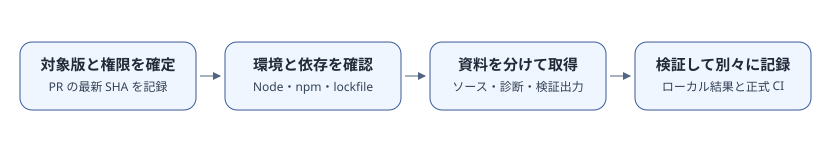

# 通常チャットで Node.js の検証を行う設計

状態: 提案中。設計案であり、実装および動作確認は未実施。

## 目的

Node.js を使うプロジェクトで、通常チャット内に実際の実行環境がある場合、許可された範囲で対象コミットの検証とCI診断の調査を行えるようにする。実行できない検査、対象が一致しない資料、CIでスキップされた工程を成功扱いにしない。

この設計が定めるのは検証資料と結果の扱いである。既存の経路選択、権限、CI workflow、配布builder、共通契約は変更しない。

## 実装方針

現行の配布物は統合 `chatgpt-worker-skills.zip` 一つである。実装・レビューの両 `SKILL.md` 本文にそれぞれ自己完結した短い手順を置く。ZIPに含まれない設計書への相対リンクを、その手順の実行条件にしない。この設計書は詳細、用語、受け入れ条件を整理する。

検証では次の三つの識別情報を混同しない。

| 識別情報 | 意味 |
| --- | --- |
| 取得元の基準SHA | connectorから取得する正式なrepository snapshotのcommit SHA。 |
| 検証候補 | 実際にローカルで調べる内容。未コミット・未pushの内容も含められる。baseline SHAに加えてmanifestまたはcontent fingerprintで特定する。 |
| PR現在SHA | PRがある場合にconnectorから取得する現在のPR head SHA。候補またはCI runとの一致を別途確認する。 |

## 実装詳細

図の左端は基準 SHA・検証候補・PR 現在 SHA の三者を区別します。ローカル検証だけが先に行われる場合、PR の情報は未設定のまま扱います。

### 入力

開始時に、IssueまたはPRから対象リポジトリと許可範囲を確認する。実行可能性は実際に使えるshell等と権限から判断し、ChatGPT環境だからNode.jsやnpmが使えるとは推定しない。利用可能な場合に限り `node --version` と `npm --version` を確認し、その出力をruntimeの存在確認として記録する。

connectorで対象の正式な取得元SHAを確定する。対象がPRなら、同じ時点のPR現在SHAも取得する。現在SHAを確認できない場合は、PRをそのSHAに固定できたとは扱わない。

### ソースと診断資料の取得

connectorを使い、既存の許可範囲で次を読む。

- 取得元基準SHAのrepository fileまたはsource archive。
- 対象SHAに結び付くCI runのmetadata。
- 利用可能なCI診断artifact。例: source ZIP、run ID、`stdout`、`stderr`、test result、validation summary。

必要な資料をconnectorからローカル実行環境へ移す際は、その環境で既に許可された転送手段だけを使う。認証が必要なprivate repositoryやartifactを、未認証の `git clone`、直接REST呼出し、別資格情報で代替しない。必要なconnector権限や資料が得られなければ、その資料に依存する調査は未確認またはblockedとして記録する。

リポジトリのソース、取得した CI 診断・添付資料、新たに生成する検証出力は、それぞれ別の一時領域に置く。コネクタが返すファイル参照と、実体化・展開後にコマンドが開くローカルパスは別に記録する。ZIPは展開前にファイル名と展開先を確認し、想定外のパスを展開しない。展開後、記録された対象SHA、archive metadata、manifest、または提供されたhashを照合する。診断artifactにsourceが含まれていても、正式ソースへ混ぜず、診断用資料として分離する。

取得元SHAはrepositoryのbaselineを示す。作業中の候補がdirty、未コミット、または未pushなら、baseline SHAだけで候補内容を表さず、対象file一覧とcontent fingerprint等で候補を識別する。file不足、照合情報不足、SHAまたはfingerprint不一致は未確認として扱い、その内容の検査結果を正式対象へ結び付けない。

### Node.js依存と検査

Node/npmのruntime確認後、対象プロジェクトの `package.json`、lockfile、既存 `node_modules`、利用可能なpackage cache、プロジェクトで定義されたscriptを読む。lockfileが指定するpackage manager・version条件と選んだコマンドが適合するか確認する。既存依存を使う場合も、検証対象のlockfileとの対応を記録する。

依存取得が必要な場合は、プロジェクトの指示と許可範囲に従い、レビュー対象を変更しない許可済みの一時領域で実施する。npm の例は、対象プロジェクトが許す場合の `npm ci`。ネット利用不可、取得権限不足、依存未導入、lockfile不一致、またはNode/npmが利用できない場合は、影響する検査を未実施またはblockedとし、成功として扱わない。グローバル導入や認証設定変更はこの手順から許可されない。

実行順の例は次のとおり。実際には対象プロジェクトが定めるコマンドと順序を優先する。

1. 変更範囲に対応したfocused test。たとえば既存のNode test runnerを使う対象テスト。
2. `npm run build`、`npm run lint` など、package scriptに存在し、対象変更に必要な検査。
3. プロジェクトが要求する場合に限り、より広いtest suiteや追加検査。

scriptが存在しない、依存がない、または環境上実行不能なら、別の検査を成功扱いで代用せず、その結果を記録する。本文中のコマンドは実行手順の例であり、どのrepositoryでも利用可能だという保証ではない。

### CI診断と結果の記録

CIではrun ID、event、head SHA、job／stepの結果を確認する。対象工程の `stdout`、`stderr`、test result、artifact内のsummaryを読み、失敗原因または未完了理由を調べる。artifactが取れない、欠けている、別SHAのrunに属する場合、その診断範囲は未確認とする。

検証記録には、少なくとも次を含める。

- 実行環境と `node --version`／`npm --version` の確認結果。
- 取得元基準SHA、検証候補のmanifestまたはfingerprint、PR現在SHA。
- 実行したコマンド、終了値、結果、`stdout`、`stderr` の保存先。
- lockfileと依存の状態、未実施の検査とその理由。
- CIのrun ID、run head SHA、対象job／stepの結果、artifactと診断内容。

ローカル検証結果と正式CIは別の証拠として記録する。CI runのhead SHAがPR現在SHAと一致していても、必要な対象jobまたはstepがskip、cancel、未実施なら、その検査は成功ではない。matching runがない場合もCI未確認とする。ローカル成功をCI Greenの代用にしない。

実行例を説明する場合は架空例と明記する。実環境についてのNode/npm動作の主張は、その環境で取得したversion確認結果の範囲に限り、test、build、lint、package取得の成功を推定しない。

## 受け入れ条件

- [ ] 統合 `chatgpt-worker-skills.zip` に含まれる実装・レビュー両 `SKILL.md` だけで各担当が手順を読め、ZIP外の相対参照を必要としない。
- [ ] 取得元基準SHA、検証候補のfingerprint、PR現在SHAを分けて記録し、未コミット候補も一意に照合できる。
- [ ] コネクタのファイル参照と展開後のローカルパスを区別する。ソース、取得済みの診断・添付資料、新しい検証出力は三つの別領域に置き、許可された方法で実体化・照合する。資料不足または不一致は未確認になる。
- [ ] runtime・lockfile・既存依存を確認し、未導入・不一致・権限不足・network不可を未実施またはblockedとして報告する。
- [ ] 対象test、build/lint、必要な広い検査の実施状況と、command、exit status、stdout/stderr、source identity、環境が記録される。
- [ ] CI結果はPR現在SHA・run head SHA・対象工程を照合し、skip等を成功にしない。
- [ ] 経路選択、設定、権限、CI workflow、配布builder、共通契約に変更を要求しない。

## テスト内容

以下は設計を実装した後の確認予定であり、実施済みの結果ではない。

| テストの目的 | 対応する受け入れ条件 | 方法 | 期待結果 |
| --- | --- | --- | --- |
| ZIP単体で手順が読める | 1 | 既存builderで生成した統合ZIPを展開し、実装・レビュー両 `SKILL.md` の手順を読む | どちらも外部file参照なしで必要な判断と記録項目を説明する |
| SHAと候補識別の分離 | 2 | baseline、未コミット候補fingerprint、PR SHAが異なる例を確認する | 三者が別項目で記録され、対象の混同が起きない |
| ソース・artifact照合 | 3 | ソース・取得済み診断・新規検証出力の三領域と、取得参照・展開先の区別を確認し、対象一致・不足・不一致の例を照合する | 一致した内容だけを対象とし、不足・不一致を未確認として残す |
| 依存・実行不能時の扱い | 4 | runtimeなし、lockfile不適合、依存取得不可、必要権限なしの例を確認する | 影響検査が未実施またはblockedで記録される |
| 検査順と診断記録 | 5 | focused test、build/lint、要求された広い試験の例を確認する | 実行したコマンドと終了値・出力・対象・環境が結び付く |
| CI工程の判定 | 6 | 一致SHAで全対象工程成功、一部skip、別SHA、artifact不足のrunを確認する | 全対象工程成功だけがCI成功となり、他は未確認または未成功になる |

未実施の項目を成功として記載しない。例示に使うtest/build/lintの成功記録は架空であると明示する。
