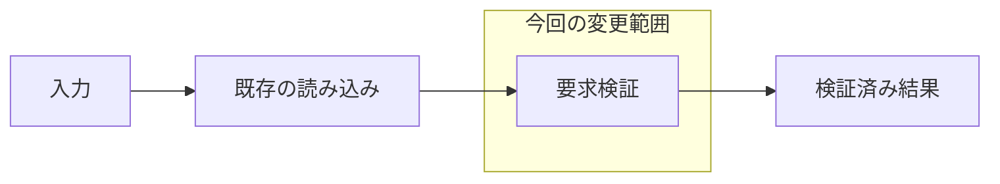

# <設計書の題名>

状態: <設計済み / 提案中 / 未検証。本文内で状態が異なる要素があれば、それぞれ明記する。>

## 目的

<新規機能の場合は狙いを書く。不具合対応の場合は観測した症状と確認済みの原因を書く。未確認の原因は断定せず、未特定と記す。>

## 実装方針

<処理全体の流れと変更箇所を説明する。共通ライブラリは責務境界、接続口、入出力を中心にする。製品固有の起動・運用手順が必要なら別文書に分け、この設計書では境界と関連文書へのリンクを示す。>

<図の例では「要求検証」が今回の変更範囲であることを、明示ラベル「今回の変更範囲」で示している。枠線や配色だけに意味を持たせない。図のブロック名は本文の見出しや型名と同じ表記にし、処理名を変えるときは図と本文の両方を合わせて変更する。図に登場するブロックは本文で説明する。>

## 実装詳細

### 入力

<入力元、形式、必須条件、既定値、拒否条件を記す。>

### 既存の読み込み

<既存処理を説明する。今回の変更範囲外であっても、変更処理との接続に必要な内容を記す。>

### 要求検証

<責務、接続口、処理、失敗時の扱いを記す。図のブロック名や公開型名と揃える。C# の公開境界を例示するときは、日本語の XML コメントで型・メンバーの役割と引数・戻り値を説明する。>

### 検証済み結果

<戻り値、状態、診断などの形式と意味を記す。>

<同じ軸で比べる情報が複数ある場合は短い表を使う。例:>

| 担当 | 責務 |
| --- | --- |
| 共通ライブラリ | <製品に依存しない処理> |
| 呼出側 | <製品固有の変換・検証・起動> |

<複数の候補や入力条件、採用規則を比較するときは同じ軸を列にする。たとえば入力条件と採用規則、検証対象と期待結果を短い表にまとめる。長い説明や処理順は本文または図に書き、表を説明文の代わりにしない。>

### 想定事象

<入力条件、状態の変化、外部依存、再実行・競合などから、今回の変更に関係する事象を洗い出す。通常・境界・失敗のうち該当するものを記す。同じ扱いになる事象はまとめ、対象外とする場合は理由を残す。>

<以下は記入例。要求の件数が 1～10 件なら検証済み結果を返し、不正な要求は後続に渡さない。実際の仕様に置き換える。>

| 事象 ID | 区分 | 前提・入力・操作 |
| --- | --- | --- |
| S-01 | 通常 | 要求を 3 件受け取る |
| S-02 | 境界 | 上限の 10 件を受け取る |
| S-03 | 失敗 | 上限を超える 11 件を受け取る |

## 受け入れ条件

- [ ] AC-01（S-01、S-02）：受け取った件数と同じ件数を検証済み結果として返す。
- [ ] AC-02（S-03）：件数の上限超過を返し、後続処理には一件も渡さない。

## テスト内容

| テストの目的 | 対応する受け入れ条件 | 方法 | 期待結果 |
| --- | --- | --- | --- |
| T-01：通常件数を確認 | AC-01 | 3 件を渡す | 検証済み結果は 3 件 |
| T-02：上限ちょうどを確認 | AC-01 | 10 件を渡す | 検証済み結果は 10 件 |
| T-03：上限超過を確認 | AC-02 | 11 件を渡し、返り値と後続処理を観測する | 上限超過を返し、後続処理は呼ばれない |

<事象から受け入れ条件、受け入れ条件からテストを ID で追えるか見直す。必要に応じて一つの条件に複数の事象やテストを対応させる。順序を変えても ID は変えず、対応のない事象や未検証の条件は理由とともに残す。検証予定と実測結果を区別する。>
