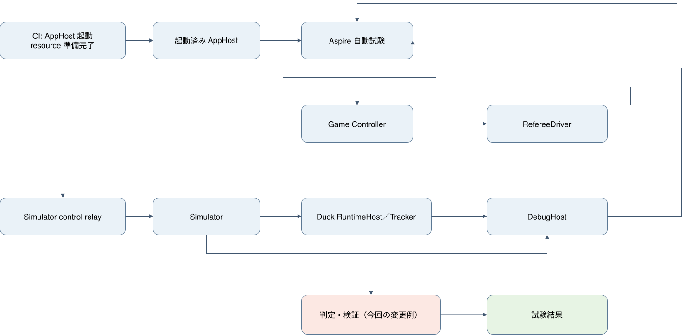
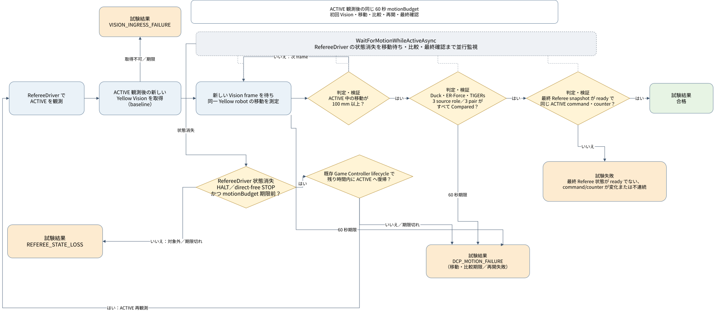

# <設計書の題名>

<設計書には再現に必要な環境条件（OS・構成・版など）、設計上の制約、受け入れ条件、テスト計画を記す。現時点の実測結果・受け入れ状況は検証レポートへ分け、必要ならリンクする。設計本文に進捗・承認状況は書かない。>

<PC 固有名や非公開 Todo リンクは記載しない。Issue 番号は記載できる。再現に必要な OS・構成・版は残す。>

## 目的

<新規機能の場合は狙いを書く。不具合対応の場合は観測した症状と確認済みの原因を書く。未確認の原因は断定せず、未特定と記す。>

## 実装方針

<処理の流れを設計書で説明する場合は、必ず対応するフロー図を添える。図は編集可能な Draw.io `.dio.svg` とし、Markdown から相対リンクする。全体図の後に詳細図を置き、今回変わる処理を図中で明示する。図は処理順・分岐、表は条件・操作・期待結果を短く示す。同じ図やルールを別ファイルに重複させない。共通ライブラリは責務境界、接続口、入出力を中心にする。製品固有の起動・運用手順が必要なら別文書に分け、この設計書では境界と関連文書へのリンクを示す。>



<この図は既存の Aspire 自動試験を題材にした模式図であり、個別設計の実装接続図ではない。例の試験は起動済み AppHost に接続し、AppHost 自体は試験メソッドが起動しない。矢印は既存テスト・設定で確認した境界だけを表す。色付きの「判定・検証」ノードを変更対象と仮定した例である。実際の図はコード・設定・試験を確認し、今回変わる処理だけを明示する。枠線や配色だけに意味を持たせない。図の処理名は本文の見出しや型名と同じ表記にし、図、本文、条件・結果の表を合わせて変更する。図に登場する処理は本文で説明する。>

## 実装詳細

### 入力

<入力元、形式、必須条件、既定値、拒否条件を記す。>

### Aspire 自動試験

<試験が AppHost を起動するか、起動済み環境へ接続するかを明記する。例の `FullStack_ReachesActiveRefereeAndMovesCraneRobot` は `DUCK_ASPIRE_STACK_ID` で起動済みスタックを特定し、Game Controller、RefereeDriver、DebugHost などの endpoint を解決する。CI の例では AppHost 起動と resource の準備完了後に試験を実行する。>

### 起動済み AppHost

<試験境界に含む起動済み resource と、試験側が利用する endpoint を記す。例では Game Controller、RefereeDriver、Simulator control relay、Simulator、Duck RuntimeHost／Tracker、DebugHost が対象であり、起動・準備完了はテストメソッドの外で行う。>

### Game Controller／RefereeDriver

<試験側の Game Controller control API 操作、Game Controller から RefereeDriver への審判 UDP、RefereeDriver から試験側への health・状態観測を記す。接続方向は実装で確認する。>

### Simulator

<試験側のセットアップ要求から Simulator control relay を経る入力と、Vision の送信先を記す。>

### Duck RuntimeHost／Tracker

<Simulator から受ける Vision、Tracker の出力、DebugHost など観測先との境界を記す。C# の公開境界を例示するときは、日本語の XML コメントで型・メンバーの役割と引数・戻り値を説明する。>

### DebugHost

<受信・観測する Vision と Tracker の情報、試験側が読む health endpoint と返却内容を記す。>

### 判定・検証

<受け入れ条件、境界値、共通の期限、失敗時の扱いを記す。例の全体試験では RefereeDriver の有効状態、DebugHost が観測する新しい Yellow Vision、ロボット移動、Tracker 比較結果を検証する。>

### 試験結果

<想定する合否、診断、成果物の形式と意味だけを記す。現時点の実測結果・受け入れ状況は検証レポートへ分け、必要ならリンクする。>

<詳細図は全体図の複製にせず、判定条件と合否を示す。次は同じ既存 Aspire 試験経路の模式例。最初の Yellow Vision、移動待ち、比較、最終 Referee 確認は ACTIVE 観測後の同じ 60 秒 motionBudget を使う。RefereeDriver の状態監視は callback 全体で並行し、HALT または direct-free STOP のみ残り時間で再開する。通常 STOP やその他の状態消失は再開せず失敗とする。>



<例の条件と結果を図や本文見出しと同じ処理名でたどれる表にする。実装・既存テストで裏付けられない接続、値、結果は仮定またはテスト計画と明記する。>

| 処理 | 条件・観測 | 期待する結果 |
| --- | --- | --- |
| 起動済み AppHost → Aspire 自動試験 | AppHost が起動し resource が準備完了してから試験を開始 | `DUCK_ASPIRE_STACK_ID` で同じスタックの endpoint を解決 |
| Aspire 自動試験 → Game Controller → RefereeDriver → Aspire 自動試験 | team identity と審判状態を Game Controller control API・RefereeDriver health で確認 | ACTIVE の観測時刻を判定・検証へ渡す |
| Simulator → Duck RuntimeHost／Tracker → DebugHost → Aspire 自動試験 | Tracker UDP 出力と比較元を観測 | DebugHost が Duck、ER-Force、TIGERs の 3 role と 3 pair の Compared 状態を返す |
| Simulator → DebugHost → Aspire 自動試験 | ACTIVE 観測時刻より新しい Yellow Vision とロボット座標を確認 | 新しい Vision と移動量を判定・検証へ渡す |
| 判定・検証 | 新しい Yellow Vision → ACTIVE 中の 100 mm 移動 → 3 role／3 pair の Compared → 最終 Referee snapshot の ACTIVE・command・counter を同じ 60 秒枠で順に確認 | 成功なら合格。初回 Vision 未取得は `VISION_INGRESS_FAILURE`、移動・比較期限切れは `DCP_MOTION_FAILURE`、最終状態の不一致は Referee 状態エラー |
| 試験結果 | 判定・検証の想定結果と診断項目 | `acceptance-result.json` など、設計した成果物の形を示す。実測・受け入れ状況は検証レポートに記す |

<同じ軸で比べる情報が複数ある場合は短い表を使う。複数の候補や入力条件、採用規則を比較するときは同じ軸を列にする。長い説明や処理順は本文または図に書き、表を説明文の代わりにしない。>

<コードを示す場合は、説明に必要な短い抜粋だけを載せ、同じキー・処理名・値を表と対応させる。実在コードには固定コミットの行リンクを付け、説明用コードはその旨を明記する。>

<例: Duck の設定解決処理 `ResolveBallTracker` にある実コード（[固定コミットの該当行](https://github.com/ibis-ssl/Duck/blob/a89f4a753a9e84b9df880e1c064178ed180da6fb/Tracker/Tracker.DebugHost/Tracking/TrackerConfigurationResolver.cs#L111)）。>

```csharp
Gate = runtimeOverrides.Gate ?? profile.Gate,
```

<下表は同じ固定コミットの `sim` profile と空の `RuntimeOverrides` を示す[設定値](https://github.com/ibis-ssl/Duck/blob/a89f4a753a9e84b9df880e1c064178ed180da6fb/Tracker/Tracker.DebugHost/appsettings.json)の例。>

| キー | profile 値 | runtime override | 適用規則 | 採用値 |
| --- | --- | --- | --- | --- |
| `BallTracker.Gate` | `1.0` | 未指定（null） | override が null なら profile 値を使う | `1.0` |

### 想定事象

<入力条件、状態の変化、外部依存、再実行・競合などから、今回の変更に関係する事象を洗い出す。通常・境界・失敗のうち該当するものを記す。同じ扱いになる事象はまとめ、対象外とする場合は理由を残す。>

<次は記入例。経路は既存 `FullStack_ReachesActiveRefereeAndMovesCraneRobot` と workflow の起動順に沿う。テストが起動済み AppHost に接続する境界、Vision の二つの受信先、Tracker 出力先をコードで確かめてから実際の図・条件に置き換える。>

| 事象 ID | 区分 | 対象処理 | 前提・入力・操作 |
| --- | --- | --- | --- |
| S-01 | 通常 | 起動済み AppHost → Aspire 自動試験 → Game Controller → RefereeDriver → Aspire 自動試験 → 判定・検証 | resource 準備完了後、試験が team identity と審判状態を観測する |
| S-02 | 境界 | Simulator → DebugHost → Aspire 自動試験 → 判定・検証 | ACTIVE 観測より新しい Yellow Vision から移動が閾値ちょうどの 100 mm と判定される |
| S-03 | 失敗 | Simulator → DebugHost → Aspire 自動試験、Duck RuntimeHost／Tracker → DebugHost → Aspire 自動試験 → 判定・検証 → 試験結果 | 同じ 60 秒枠内に 100 mm 移動または 3 role／3 pair の Compared が揃わない |
| S-04 | 境界 | RefereeDriver → Aspire 自動試験 → Game Controller → RefereeDriver → Aspire 自動試験 → 判定・検証 | ACTIVE 中の HALT または direct-free STOP 後、既存 lifecycle が同じ 60 秒枠内に再開する |
| S-05 | 失敗 | Game Controller → RefereeDriver → Aspire 自動試験、Simulator → DebugHost → Aspire 自動試験 → 判定・検証 → 試験結果 | ACTIVE 観測時刻より新しい Yellow Vision を DebugHost から同じ 60 秒枠内に取得できない |

## 受け入れ条件

<次はこの試験例に対する受け入れ条件の記入例。個別設計では事象と変更内容に合わせて置き換える。チェック状態や現在の受け入れ状況は設計書に置かず、検証レポートに記す。>

- AC-01（S-01、S-02、S-04）：Aspire 自動試験は起動済み AppHost の resource と状態を観測し、閾値ちょうどの移動と対象 lifecycle の再開を条件どおり判定する。
- AC-02（S-03）：同じ 60 秒枠内に 100 mm 以上の移動または 3 role／3 pair の Compared が揃わない場合、判定・検証は `DCP_MOTION_FAILURE` を期待する。
- AC-03（S-05）：RefereeDriver の ACTIVE 観測時刻より新しい Yellow Vision を DebugHost から同じ 60 秒枠内に取得できない場合、判定・検証は `VISION_INGRESS_FAILURE` を期待する。

## テスト内容

<次はこの試験例に対するテスト内容の記入例。個別設計では受け入れ条件に合わせて置き換える。実測結果は検証レポートに記す。>

| テスト ID・目的 | 対応する受け入れ条件 | 方法 | 期待結果 |
| --- | --- | --- | --- |
| T-01：全体経路を確認 | AC-01（S-01） | 起動済み AppHost に接続する `FullStack_ReachesActiveRefereeAndMovesCraneRobot` の試験経路を実行 | team identity、RefereeDriver 状態、移動、DebugHost 比較を条件どおり判定 |
| T-02：100 mm 閾値ちょうどを確認 | AC-01（S-02） | `RobotMotionAcceptanceVerifierTests.FindMovement_RequiresTheMinimumDistanceAndReportsObservedMovement` で 100 mm を与える | 閾値以上として扱う |
| T-03：移動・比較期限切れを確認 | AC-02（S-03） | 移動または Compared 条件を欠かせて同じ期限を適用するテストを計画 | 60 秒期限後に `DCP_MOTION_FAILURE` を期待 |
| T-04：Referee lifecycle の再開を確認 | AC-01（S-04） | HALT または direct-free STOP を挟み、残りの同じ 60 秒枠で再 ACTIVE となる経路を確認するテストを計画 | 再開後に同じ期限・判定を継続 |
| T-05：新しい Yellow Vision の期限切れを確認 | AC-03（S-05） | ACTIVE 観測時刻より後の Yellow Vision を DebugHost で観測できない条件を与えるテストを計画 | 同じ 60 秒期限後に `VISION_INGRESS_FAILURE` を期待 |

<事象から受け入れ条件、受け入れ条件からテストを ID で追えるか見直す。必要に応じて一つの条件に複数の事象やテストを対応させる。順序を変えても ID は変えず、対応のない事象や未検証の条件は理由とともに残す。>
