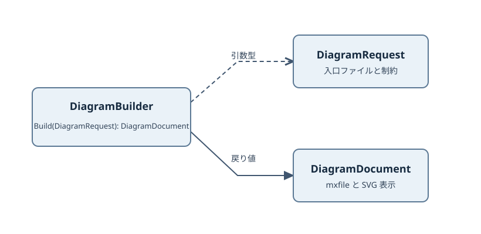
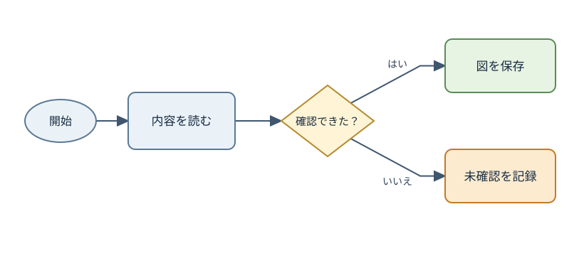

# draw.io Diagrams

## Goal

Create compact design diagrams that remain readable in Markdown and editable in draw.io.

## Runtime independence

Use repository files and available local tools. Do not assume a particular operating system, editor installation, MCP connection, or permission to change files outside the task scope.

## Inputs

- Design prose, code or an existing diagram that defines what the drawing must show.
- Repository instructions for paths, Markdown references, diagram conventions and document checks.
- Existing diagram files when updating a drawing.

## Required flow

1. Check for an existing diagram skill, related examples and repository conventions before choosing a format or path.
2. Choose a **class relationship** diagram for types, responsibilities and dependencies. Choose a **flow** diagram for ordered steps, data movement, decisions and failure outcomes. Split the views when combining them makes either one hard to read; use the same names for shared components.
3. Create or update a real draw.io `.dio.svg`. Keep both the standalone SVG drawing and the embedded draw.io model. Do not rename a plain SVG or substitute a screenshot. Reference the file from Markdown with an image embed and repository-relative path.
4. Keep labels short. Make arrow direction and relationship meaning clear. Include boundaries only when they explain ownership or an external dependency. Preserve repository vocabulary and document rules.
5. Validate the model and its two display paths separately:
   - **Embedded model:** inspect the SVG `content` and embedded draw.io `mxfile`. If a `<diagram>` payload is compressed, decode it and check the expanded `mxGraphModel` labels and connectors; if it cannot be expanded, mark those details unverified. The [official draw.io Skill](https://github.com/jgraph/drawio-mcp/blob/main/plugins/codex/drawio/skills/drawio/SKILL.md) notes CLI `-e` for embedding diagram XML in an export. Embedded XML alone does not prove an edit round-trip.
   - **Model redraw:** use draw.io to export a PNG from the `.dio.svg`, which asks draw.io to read its embedded model and redraw it. Attempt this independently from the static render so one failure does not skip the other. Record its command status and whether output was produced.
   - **Static SVG drawing:** render the same `.dio.svg` directly with an SVG renderer such as Inkscape, without routing it through draw.io. Attempt it even if model redraw failed. Check Japanese text, connectors, clipping and page bounds; record it separately. This confirms the standalone SVG artwork, not the embedded model.
   - **Edit round-trip:** when draw.io is available and permitted, copy the existing file to a temporary path, change one visible label, save and reopen the copy, then confirm that the changed label appears in both the model and drawing and that connectors remain. Do not alter the original just to test editing.
6. Report each check independently. If the editor or renderer is unavailable, mark that check unverified and give the reason. A parse or embedded-model check alone does not prove editability or correct rendering.

### Default: existing CLI with its sandbox enabled

Prefer an already installed, authorized `drawio` CLI. The default route uses no download and leaves Electron's sandbox enabled. Before opening or rendering a diagram, inspect it for external image references (`<image href="https://…">`, CSS `url(https://…)`, or linked assets). Importing or rendering such content can make network requests; use trusted local-only inputs or an appropriately network-restricted environment, and record any external references that cannot be resolved safely. Do not treat permission to download the application as permission for a diagram to fetch remote content.

The input path is relative to the current repository root. Set it explicitly before running the workflow; do not assume the current directory is the CodexSkill checkout:

```bash
# From the CodexSkill repository root:
DIAGRAM_INPUT=skills/drawio-diagrams/examples/class-relations.dio.svg

# Or from a consumer repository root after its .agents/skills link is configured:
# DIAGRAM_INPUT=.agents/skills/drawio-diagrams/examples/class-relations.dio.svg
```

CodexSkill's `scripts/link_consumer_skills.py <consumer-repo>` creates that consumer link; use the consumer's existing `.agents/skills` setup and do not replace paths manually.

Run the commands in the same Bash session with `set -euo pipefail`. Install an EXIT trap before creating a fresh temporary directory so that ordinary success and command failures both remove it while preserving the original exit status:

```bash
set -euo pipefail
work=
cleanup() {
  status=$?
  trap - EXIT
  if [[ -n "$work" && -d "$work" ]]; then
    rm -rf -- "$work" || { printf 'temporary cleanup failed: %s\n' "$work" >&2; status=1; }
  fi
  if [[ -n "$work" && -e "$work" ]]; then
    printf 'temporary directory remains: %s\n' "$work" >&2
    status=1
  fi
  if [[ -n "$work" && ! -e "$work" ]]; then
    printf 'temporary cleanup: removed\n'
  fi
  exit "$status"
}
trap cleanup EXIT
work="$(mktemp -d)"
mkdir -p "$work/config" "$work/cache"
export XDG_CONFIG_HOME="$work/config" XDG_CACHE_HOME="$work/cache"
diagram="${DIAGRAM_INPUT:?Set DIAGRAM_INPUT to a path relative to the current repository root}"
[[ -f "$diagram" ]] || { printf 'diagram input not found: %s\n' "$diagram" >&2; exit 2; }
cp -- "$diagram" "$work/source.dio.svg"
drawio=drawio
drawio_flags=()
# On a headless host, an installed CLI may need only this flag; keep its sandbox enabled.
# drawio_flags=(--ozone-platform=headless)
```

If the installed CLI is missing, stop and report the CLI route as unverified unless the optional fallback below is explicitly allowed. Select one CLI route before continuing. For the default installed CLI, leave `drawio=drawio` and `drawio_flags=()` as shown. The one-label edit below uses Python's standard library on the temporary mxfile; it is not a GUI edit. The import/export sequence verifies a headless model round-trip, not graphical-editor interaction.

```bash
"$drawio" "${drawio_flags[@]}" -x -f xml -o "$work/model.drawio" "$work/source.dio.svg"
cp "$work/model.drawio" "$work/edited.drawio"
python3 - "$work/edited.drawio" <<'PY'
from pathlib import Path
import sys
import xml.etree.ElementTree as ET
path = Path(sys.argv[1])
tree = ET.parse(path)
cell = next(cell for cell in tree.iter() if cell.tag == "mxCell" and cell.get("id") == "document")
value = cell.get("value", "")
assert "DiagramDocument" in value
cell.set("value", value.replace("DiagramDocument", "DiagramDocument (編集確認)", 1))
tree.write(path, encoding="utf-8", xml_declaration=True)
PY
"$drawio" "${drawio_flags[@]}" -x -f svg -e -o "$work/edited.dio.svg" "$work/edited.drawio"
reload_status=0
if "$drawio" "${drawio_flags[@]}" -x -f xml -o "$work/reopened.drawio" "$work/edited.dio.svg"; then
  [[ -s "$work/reopened.drawio" ]] || reload_status=1
else
  reload_status=$?
fi
model_status=0
if "$drawio" "${drawio_flags[@]}" -x -f png -o "$work/model-redraw.png" "$work/edited.dio.svg"; then
  [[ -s "$work/model-redraw.png" ]] || model_status=1
else
  model_status=$?
fi
static_status=0
if inkscape "$work/edited.dio.svg" --export-filename="$work/static-svg.png"; then
  [[ -s "$work/static-svg.png" ]] || static_status=1
else
  static_status=$?
fi
printf 'XML reload exit=%s\n' "$reload_status"
printf 'model redraw exit=%s\n' "$model_status"
printf 'static SVG exit=%s\n' "$static_status"
model_png_out="${MODEL_PNG_OUT:-}"
static_png_out="${STATIC_SVG_PNG_OUT:-}"
save_status=0
if [[ -n "$model_png_out" ]]; then
  if [[ "$model_status" -eq 0 && -s "$work/model-redraw.png" && ! -e "$model_png_out" ]]; then
    cp -- "$work/model-redraw.png" "$model_png_out" || save_status=1
  else
    printf 'requested model PNG not saved\n' >&2
    save_status=1
  fi
fi
if [[ -n "$static_png_out" ]]; then
  if [[ "$static_status" -eq 0 && -s "$work/static-svg.png" && ! -e "$static_png_out" ]]; then
    cp -- "$work/static-svg.png" "$static_png_out" || save_status=1
  else
    printf 'requested static SVG PNG not saved\n' >&2
    save_status=1
  fi
fi
overall_status=0
if [[ "$reload_status" -ne 0 || "$model_status" -ne 0 || "$static_status" -ne 0 || "$save_status" -ne 0 ]]; then
  overall_status=1
fi
printf 'overall exit=%s\n' "$overall_status"
```

Check the changed label in `reopened.drawio` and the SVG's embedded `content` model when XML reload succeeds. Inspect both temporary PNGs separately while the Bash session is still open. Set `MODEL_PNG_OUT` or `STATIC_SVG_PNG_OUT` only when the user explicitly requests that image, to a non-existing destination outside the repository; no images are copied by default or overwrite existing files. Record XML reload, both renderer, and requested-copy statuses before finishing. A failed XML reload marks the readback check unverified but does not skip either renderer or a successful requested-image copy. Then run `exit "$overall_status"`; any readback, renderer or copy failure makes the final status nonzero. The EXIT trap removes the temporary package, profile, model, SVG and PNG on both success and ordinary failure, and reports whether the directory was removed. If cleanup itself fails, report it instead of claiming a clean run. Abrupt process termination can bypass a shell EXIT trap.

After inspection and any explicitly requested image copy, finish the Bash session with:

```bash
exit "$overall_status"
```

### Optional fallback: approved official release in an isolated environment

Use this only if no existing CLI is available, downloading the official asset is authorized, and the cloud/container supplies an outer sandbox suitable for running the extracted Electron app. Run this setup in the already trapped Bash session, before the shared import/export commands above. The tested reference asset is [draw.io Desktop v32.7.4](https://github.com/jgraph/drawio-desktop/releases/tag/v32.7.4), `drawio-amd64-32.7.4.deb`, SHA-256 `ffd8c110f1df8cde26a7fbd801212bd8381d257879f424a2191ec4cc491aa50b`. Confirm the exact selected asset and digest against official release metadata; do not reuse this digest for another version. Extract with `dpkg-deb -x` under the already trapped `$work`, not with a package installer:

```bash
deb="$work/drawio-amd64-32.7.4.deb"
curl -fL -o "$deb" https://github.com/jgraph/drawio-desktop/releases/download/v32.7.4/drawio-amd64-32.7.4.deb
printf '%s  %s\n' ffd8c110f1df8cde26a7fbd801212bd8381d257879f424a2191ec4cc491aa50b "$deb" | sha256sum -c -
dpkg-deb -x "$deb" "$work/root"
drawio="$work/root/opt/drawio/drawio"
drawio_flags=(--ozone-platform=headless)
```

Only for this extracted-app fallback, a Linux host without an X server needed `--ozone-platform=headless`; the default export failed with missing `$DISPLAY`. The extracted helper also refused to run without `--no-sandbox` because it was not root-owned setuid. Add `--no-sandbox` to `drawio_flags` only when the outer cloud/container sandbox is confirmed; never change helper permissions or run untrusted diagrams without isolation. `--disable-gpu` was used in the successful run, but its necessity was not tested. Do not add these flags to the default installed-CLI example. If the download, digest, sandbox condition or cleanup cannot be confirmed, stop and report the check as unverified.

## Examples

- Class relationships: 
- Processing flow: 

## Outputs

Return the relative paths, the distinction each diagram communicates, and separate results for model structure, normal display and edit round-trip. List unavailable checks as unverified.

## Completion condition

Complete when each diagram has one clear purpose, Markdown references resolve, the SVG drawing and embedded model have been checked independently, and verification gaps are explicit. Add scripts or dependencies only when repeated work demonstrates a need that existing tools cannot meet.
